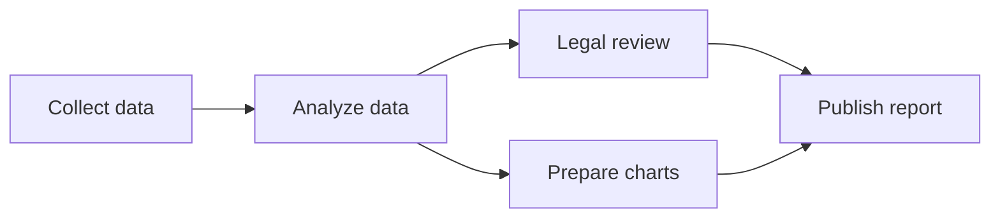

# Examples

Illustrative tasks showing how the five principles apply to general work and coding. The complete rules are in [SKILL.md](skills/karpathy-guidelines/SKILL.md).

## 1. Think Before Acting

### General task: compare options

**Request:** "Compare these three suppliers and recommend one."

A weak response assumes that lowest price is the only criterion, invents missing reliability data, and gives a confident winner.

A useful response reads the supplied material, identifies the known costs and service terms, and distinguishes them from missing information. If budget and reliability lead to different recommendations, it explains that tradeoff and asks which constraint matters while completing the factual comparison.

### Coding task: export user data

**Request:** "Add a feature to export user data."

A weak implementation silently chooses all users, all fields, two output formats, and a file location.

A useful approach inspects existing export patterns and data permissions, then clarifies the remaining choices that affect scope: which users, which fields, and where the export is delivered. It reuses facts already present in the project.

## 2. Simplicity First

### General task: explain a term

**Request:** "What does a dependency mean in a project plan?"

A useful answer gives the meaning and a concrete example:

> A dependency means one task needs another task's result before it can proceed. For example, printing invitations depends on approving their text.

A scheduling application would add work without helping this request.

### Coding task: calculate a percentage discount

**Request:** "Add a function that calculates a percentage discount."

Implement the required calculation directly:

```python
def calculate_discount(amount, percent):
    return amount * (percent / 100)
```

Add other discount types, configuration, or strategy classes only when the task calls for them. Follow the project's established input-validation contract.

### Disposable artifacts

**Request:** "Help me explore how a changing input affects this process."

An interactive page can be useful even if opened once. Its interactions should answer that question; authentication, a backend, and a reusable component framework need a separate reason.

## 3. Surgical Changes

### General task: update a document

**Request:** "Change the review date and update the references that use it."

Update the date and its dependent references. Preserve unrelated wording, section order, and formatting. Mention a relevant inconsistency outside that change rather than rewriting the document incidentally.

### Coding task: whitespace in emails

**Request:** "Treat whitespace-only emails as empty in this validator."

Assume inspection confirms that the existing contract accepts strings or `None` and requires a nonempty email. Change that check:

```diff
  email = user_data.get('email')
- if not email:
+ if not email or not email.strip():
      raise ValueError('Email required')
```

Check the affected behavior. Keep unrelated username validation, naming, and formatting outside the change.

## 4. Goal-Driven Execution

### General task: summarize source material

**Request:** "Summarize these reports and explain where they disagree."

Completion means the main claims trace to the supplied reports, disagreement is identified, and the summary distinguishes reported evidence from interpretation. Verify claims against the sources; disclose missing material that prevents a supported conclusion.

### General task: revise a document

**Request:** "Align the onboarding guide with the supplied checklist."

Check that each required item is covered, instructions match the checklist, and directly affected references remain correct. Formatting alone does not establish completeness.

### Coding task: fix a session bug

**Request:** "Old sessions still work after a password change. Fix that."

Use observable criteria:

1. Reproduce the old session remaining valid after the password changes.
2. Change the session invalidation behavior.
3. Verify that the old session is rejected and a valid new login still works.
4. Run the relevant existing regression checks.

Explain any check that could not be performed. Do not replace the specific behavior check with a claim that the code merely looks correct.

## 5. Make Results Understandable

### Clear writing

A dense explanation:

> The invocation of the synchronization mechanism facilitates the propagation of modifications contingent upon the availability of connectivity.

A clearer explanation:

> When a connection is available, synchronization sends the changes.

The condition remains explicit. Keep one term for the same concept throughout the explanation. These clarity principles apply in the user's language; the example does not establish full ASD-STE100 compliance.

### Diagrams for relationships

**Request:** "Explain why publishing this report depends on several teams."

Assume the supplied workflow says that collecting data precedes analysis, and analysis precedes both legal review and chart preparation. Both must finish before publication. Show those relationships directly:



Explain that publication waits for both branches. Check that the diagram preserves the supplied dependencies.

### Interactive HTML for exploration

**Request:** "Help me see how repeated reductions affect the remaining amount as I change the rate and number of steps."

A standalone HTML page can let the user change the reduction rate and step count, then inspect the remaining amount and its trajectory. Label the assumptions and units. Check zero reduction, the default scenario, and full reduction, then exercise the controls and confirm that the displayed values match the calculation.

Place the file according to workspace conventions and link it from the response. Keep only interactions that help answer the question. If the environment cannot produce or display the artifact, explain that limitation and offer a supported alternative.

### Format choice follows the question

| User need | Suitable response |
|-----------|-------------------|
| Understand a simple term | A short definition and example |
| Understand relationships or a process | A diagram with the necessary explanation |
| Explore parameter changes or scenarios | Interactive HTML with checked behavior |
| Assess completed work | Result, key evidence, material assumptions, and verification as needed |

These are decision criteria, not a required progression through formats. A long answer alone does not justify creating a page. The user's requested format takes precedence.
